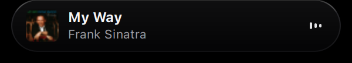
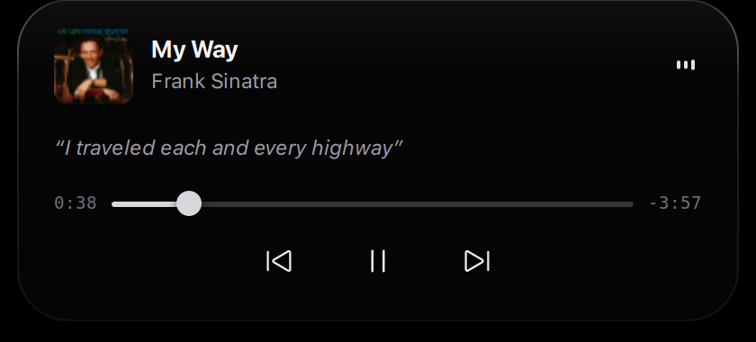

# Dynamic Notch

A lightweight, Dynamic Island-style desktop companion for Linux laptops, built with Python, GTK 3 (PyGObject), and Cairo. It sits centered beneath your top panel or screen edge, providing media playback controls, synchronized lyrics, an audio-reactive equalizer, power notifications, Cinema Mode fullscreen suppression, and background hydration reminders.

---

## Features

- **Fixed-Canvas Transparency**: Uses a transparent 440×180 px drawing canvas with dynamic input shape masking (`cairo.Region`) so mouse clicks outside the active notch shape pass through seamlessly to underlying desktop windows.
- **Compact & Expanded States**:
  - **Compact Pill (280×44 px)**: Displays current track title, artist, album art thumbnail (28×28 px), and real-time equalizer bars.
  - **Expanded Player (400×178 px with lyrics / 400×146 px without lyrics)**: Expands smoothly on hover with a 60 FPS cubic ease-out curve, offering album artwork (44×44 px), seekbar with elapsed and remaining time, previous / play-pause / next buttons, and synchronized lyrics.
- **Synchronized Lyrics via LRCLIB**:
  - Multi-stage lookup with exact metadata matching, title sanitization (removing feat, remaster, radio edit tags), and candidate scoring with strict duration validation.
  - Dedicated two-line lyric presentation with natural word-boundary wrapping; lines wrap across up to two lines and overflow beyond two lines is truncated with an ellipsis.
  - Tracks playback position via lightweight MPRIS D-Bus queries and highlights current lyric lines without UI lag.
  - Falls back cleanly to `"Instrumental"` or collapses the lyric row to compact height (146 px) when unavailable—never substitutes album or artist names.
- **Audio-Reactive Equalizer**:
  - Connects to the default PipeWire sink monitor stream using `pw-record` with 32 ms latency.
  - Computes real-time 3-band energy (Bass ~160 Hz, Mid ~800 Hz, Treble ~2400 Hz) using the Goertzel discrete Fourier transform algorithm with attack/decay smoothing.
  - Automatically settles to resting bars when playback pauses and recovers gracefully if audio sinks disconnect.
- **Cinema Mode (Fullscreen Suppression)**:
  - Automatically hides the island when watching fullscreen videos, movies, or presentations in media players (VLC, MPV, browser fullscreen video, etc.).
  - Uses a dual detection mechanism: an integrated low-latency XWayland/X11 monitor querying `_NET_ACTIVE_WINDOW` / `_NET_CLIENT_LIST` plus an optional GNOME Shell D-Bus companion bridge (`org.dynamicnotch.CinemaBridge`).
  - Background media tracking and lyric prefetching continue uninterrupted while hidden, ensuring instantaneous restoration upon exiting fullscreen.
  - Includes a manual toggle CLI option: `python3 notch.py --cinema-toggle`.
- **System & Power Notifications**:
  - Displays transient in-island notification pills on charger connect/disconnect and low battery warning (<= 20%).
  - Smooth volume level indicator on mouse scroll over the notch.
- **Automatic Hydration Reminders**:
  - Runs a background timer that dispatches a gentle desktop notification via `notify-send` every 5 minutes (`WATER_REMINDER_INTERVAL_MIN = 5`), completely decoupled from the on-screen UI.

---

## Screenshots

| Compact State | Expanded Player (with Synchronized Lyrics) |
| :---: | :---: |
|  |  |

---

## Requirements

### Operating System & Desktop
- **Linux**: GNOME on Wayland (via XWayland execution backend) or standard X11 session.
- **Python**: Python 3.10 or newer.

### System Packages (Ubuntu / Debian / Pop!_OS)
```bash
sudo apt-get update
sudo apt-get install --no-upgrade \
    gir1.2-gtk-3.0 \
    python3-gi \
    python3-gi-cairo \
    python3-dbus \
    pipewire \
    wireplumber \
    libnotify-bin
```
*(The `--no-upgrade` flag ensures dependencies are installed without upgrading existing packages on your system.)*

### System Packages (Fedora / RHEL)
```bash
sudo dnf install -y \
    gtk3 \
    python3-gobject \
    python3-cairo \
    python3-dbus \
    pipewire \
    wireplumber \
    libnotify
```

### System Packages (Arch Linux)
```bash
sudo pacman -S --needed \
    gtk3 \
    python-gobject \
    python-cairo \
    python-dbus \
    pipewire \
    wireplumber \
    libnotify
```

---

## Installation & Setup

1. **Clone the repository**:
   ```bash
   git clone https://github.com/YOUR_USERNAME/dynamic-notch.git
   cd dynamic-notch
   ```

2. **Run the setup script**:
   ```bash
   chmod +x setup.sh run.sh uninstall.sh
   ./setup.sh
   ```
   The setup script behaves like a standard desktop application installer:
   - **Safe Dependency Checking**: Checks whether required system packages are already installed before taking any action.
   - **Simulation & Confirmation**: On Debian/Ubuntu systems with missing packages, it runs an `apt-get -s` simulation to detect any package upgrades and prompts for explicit user confirmation (`[y/N]`) before invoking `sudo`.
   - **Cross-Distribution Transparency**: On Fedora and Arch Linux, it identifies missing dependencies without attempting apt commands and directs you to distro-specific package manager instructions.
   - **Conservative Policy**: Never runs a full system upgrade, never upgrades existing software silently, and uses `--no-upgrade`.
   - **Desktop Menu Integration**: Generates your localized desktop launcher from `dynamic-notch.desktop.in` with the fully resolved absolute path to `run.sh` and installs it to `${XDG_DATA_HOME:-~/.local/share}/applications/dynamic-notch.desktop`.
   - **GNOME App Grid Discovery**: Automatically updates the desktop database (`update-desktop-database`) so Dynamic Notch immediately appears in your desktop application menu / GNOME App Grid.

---

## Launching & Managing Dynamic Notch

### 1. Launch from Desktop Application Menu
Once installed, Dynamic Notch behaves like any standard desktop app:
- Press **Super** (Windows key) or click **Show Applications** (grid icon).
- Type **Dynamic Notch** and click the icon to launch.
- Dynamic Notch launches cleanly in the background without displaying a terminal window (`Terminal=false`).

### 2. Manual Terminal Launch
You can also launch directly from your terminal:
```bash
./run.sh
```

### 3. Single-Instance Protection & Closing
- **Closing the Application**: Press `Ctrl+C` in terminal, or terminate the process.
- **Relaunching**: Click the launcher in your application menu to start a fresh instance.
- **Duplicate Prevention**: If Dynamic Notch is already running, launching it again from the menu or terminal automatically detects the active instance and exits safely without creating overlapping floating windows.

### 4. Optional: Autostart on Login
Autostart is **disabled by default**. To configure Dynamic Notch to start automatically when you log into your desktop:

- **Enable autostart**:
  ```bash
  ./setup.sh --enable-autostart
  ```
  *(Creates `~/.config/autostart/dynamic-notch.desktop` pointing to your installation.)*

- **Disable autostart**:
  ```bash
  ./setup.sh --disable-autostart
  ```
  *(Removes only the autostart entry; your application launcher remains installed.)*

### 5. Check Installation & Running Status
To check whether the desktop launcher, project executables, autostart, and application process are active:
```bash
./setup.sh --status
```

---

## Uninstallation

To remove the desktop launcher and autostart configuration:
```bash
./uninstall.sh
```
- **What is removed**:
  - Desktop application launcher from `${XDG_DATA_HOME:-~/.local/share}/applications/dynamic-notch.desktop`.
  - Autostart entry from `${XDG_CONFIG_HOME:-~/.config}/autostart/dynamic-notch.desktop` (if enabled).
  - Local generated launcher file.
- **What is preserved**:
  - System packages and dependencies remain untouched.
  - Project source code in your directory is safely preserved.
  - To completely delete the source files, simply remove the folder: `rm -rf /path/to/dynamic-notch`.

---

## Audio Visualizer & PipeWire Setup

Dynamic Notch uses PipeWire's built-in `pw-record` CLI utility to monitor the default audio sink without requiring complex audio routing or elevated permissions:

```bash
pw-record --target @DEFAULT_AUDIO_SINK@ --latency 32ms --rate 8000 --channels 1 --format s16 --raw -
```

- **Audio-Reactive Behavior**: When audio plays through the default sink, 32 ms PCM chunks are analyzed in real time.
- **Fallback**: If `pw-record` is not installed or the default audio sink is temporarily unavailable, the visualizer automatically falls back to a lightweight sinusoidal wave animation until the stream recovers.

---

## Cinema Mode & Fullscreen Suppression

To prevent the Dynamic Island from obscuring subtitles or video controls while watching fullscreen movies or videos:

1. **Built-in XWayland / X11 Monitor**: Automatically detects fullscreen state for windows using `_NET_WM_STATE_FULLSCREEN` on XWayland (e.g. VLC, MPV, Chrome, Electron apps).
2. **GNOME Shell Companion Bridge (Optional)**: For native Wayland fullscreen detection under GNOME Shell, install the companion extension included in `gnome-extension/`:
   ```bash
   mkdir -p ~/.local/share/gnome-shell/extensions/cinema-bridge@dynamic-notch
   cp -r gnome-extension/* ~/.local/share/gnome-shell/extensions/cinema-bridge@dynamic-notch/
   gnome-extensions enable cinema-bridge@dynamic-notch
   ```
3. **Manual Override**: Toggle suppression manually at any time via:
   ```bash
   python3 notch.py --cinema-toggle
   ```

---

## Configuration

Core behavioral parameters can be customized at the top of `notch.py`:

| Parameter | Default | Description |
|---|---|---|
| `WATER_REMINDER_INTERVAL_MIN` | `5` | Hydration reminder interval in minutes (via `notify-send`) |
| `UPDATE_INTERVAL_MS` | `1000` | Periodic metadata & power status poll interval |
| `LYRIC_TICK_MS` | `150` | Synchronized lyric tracking tick interval |
| `ANIM_EXPAND_MS` | `300` | Organic fluid expansion duration in milliseconds |
| `ANIM_COLLAPSE_MS` | `250` | Responsive cushioned collapse duration in milliseconds |
| `ANIM_INTERVAL_MS` | `16` | Fallback frame tick interval (~60 FPS) |
| `ACTIVITY_TICK_MS` | `33` | Equalizer drawing area frame tick (~30 FPS) |
| `CINEMA_POLL_MS` | `200` | Fullscreen detector poll interval |
| `MARGIN_TOP_PANEL` | `2` | Margin in pixels below the desktop top panel |
| `MARGIN_TOP_SCREEN` | `8` | Margin in pixels from top of screen if no panel exists |

---

## Automated Tests

A dedicated, deterministic unit test suite is located in `tests/`. Most tests run without requiring network access, running audio services, or an active desktop. Tests that instantiate GTK window widgets (such as `TestLyricLayoutPresentation`) connect to an active X11/XWayland display (`DISPLAY`), or can be executed using `xvfb-run` in headless CI environments:

```bash
python3 -m unittest discover tests
```

Or in headless CI environments without a physical display:
```bash
xvfb-run -a python3 -m unittest discover tests
```

Tests cover:
- LRCLIB search candidate scoring, duration tolerance validation, and title sanitization.
- Stale asynchronous response rejection and token tracking.
- AudioLevelMonitor Goertzel frequency discrimination across bass, mid, and treble tones.
- Media controller disconnection and artwork cache eviction.
- GLib timer safety and idempotent teardown.
- Animation engine lifecycle, 60 FPS cubic ease-out curves, and mid-flight reversals.
- Cinema Mode override and debounce hysteresis logic.
- Expanded lyric presentation layout, 2-line word wrapping, and reserved row height stability.

---

## Troubleshooting

### Notch is positioned over or behind the top panel
Dynamic Notch dynamically queries the primary monitor's work area via `monitor.get_workarea()`. If your desktop uses a custom panel or auto-hiding top bar, adjust `MARGIN_TOP_PANEL` or `MARGIN_TOP_SCREEN` in `notch.py`.

### Album art is not updating
Ensure your media player supports the MPRIS D-Bus interface (e.g. Spotify, Rhythmbox, VLC). The application downloads album art over HTTPS to `/tmp/dynamic_notch_art.jpg` and scales it using GdkPixbuf with rounded corners.

### Equalizer is flat while music is playing
Check that PipeWire is running and `pw-record` is available in your `$PATH`:
```bash
which pw-record
wpctl status
```

---

## Known Limitations

- **Wayland Window Positioning**: Wayland compositors isolate client windows and do not permit arbitrary window placement protocols. Dynamic Notch runs via `GDK_BACKEND=x11` (XWayland) to achieve precise top-center positioning and input shape masking.
- **Audio Capture Device**: The equalizer monitors `@DEFAULT_AUDIO_SINK@`. If your audio setup uses an external DAC or complex virtual loopback sink without a default monitor, set the appropriate sink in `pw-record`.

---

## Credits, Inspiration & Attribution

**Dynamic Notch** is an independent project created by **Shiroge (Leon)**. It was built from scratch and does not originate from or fork any other Dynamic Notch codebase.

Its visual direction and interaction concepts are inspired by:

- **[Nusa](https://rama2555.github.io/nusa/)** — a living-notch desktop companion for Windows.
- **[Apple's MacBook Pro Dynamic Island](https://www.apple.com/newsroom/2026/10/apple-unveils-groundbreaking-macbook-pro-with-proled-xdr-display/)** — a reference for compact media controls, dynamic expansion, and contextual desktop interactions.

Dynamic Notch is an independent implementation. It is not affiliated with, sponsored by, or endorsed by Nusa or Apple Inc.

### Downstream Forks & Attribution

Forks, renaming, modifications, and redistribution of this project are welcome under the terms of the MIT License.

If you redistribute this project or substantial portions of its code, retain the original copyright notice and include the MIT License as required by its terms.

If you build a fork or derivative project, crediting the original project and linking back to this repository in your README or documentation is appreciated. This acknowledgment is a courteous request, not an additional restriction beyond the standard MIT License.

## Third-Party Components & Acknowledgments

This project is an independent open-source application and makes use of the following technologies:

- **GTK 3 & PyGObject**: Distributed under the GNU Lesser General Public License (LGPL v2.1 or later).
- **Cairo (`pycairo`)**: Distributed under the LGPL v2.1 / MPL 1.1.
- **PipeWire & WirePlumber**: Distributed under the MIT License.
- **LRCLIB**: Synchronized lyrics provided via the public REST API hosted at [lrclib.net](https://lrclib.net).
- **System Symbolic Icons**: Uses standard FreeDesktop / Adwaita system icons provided by your desktop environment.
- **Design Inspiration**: Conceptually inspired by modern dynamic island and dynamic notch interaction paradigms (such as Apple macOS MacBook Pro Dynamic Island and Windows Nusa). This project is independent, not affiliated with or endorsed by Apple Inc. or Nusa, and contains no proprietary assets, fonts, or copyrighted code from those platforms.

---

## License

This project is licensed under the [MIT License](LICENSE).

```text
Copyright (c) 2026 Shiroge (Leon)

Permission is hereby granted, free of charge, to any person obtaining a copy
of this software and associated documentation files (the "Software"), to deal
in the Software without restriction, including without limitation the rights
to use, copy, modify, merge, publish, distribute, sublicense, and/or sell
copies of the Software, and to permit persons to whom the Software is
furnished to do so, subject to the following conditions:

The above copyright notice and this permission notice shall be included in all
copies or substantial portions of the Software.
```
